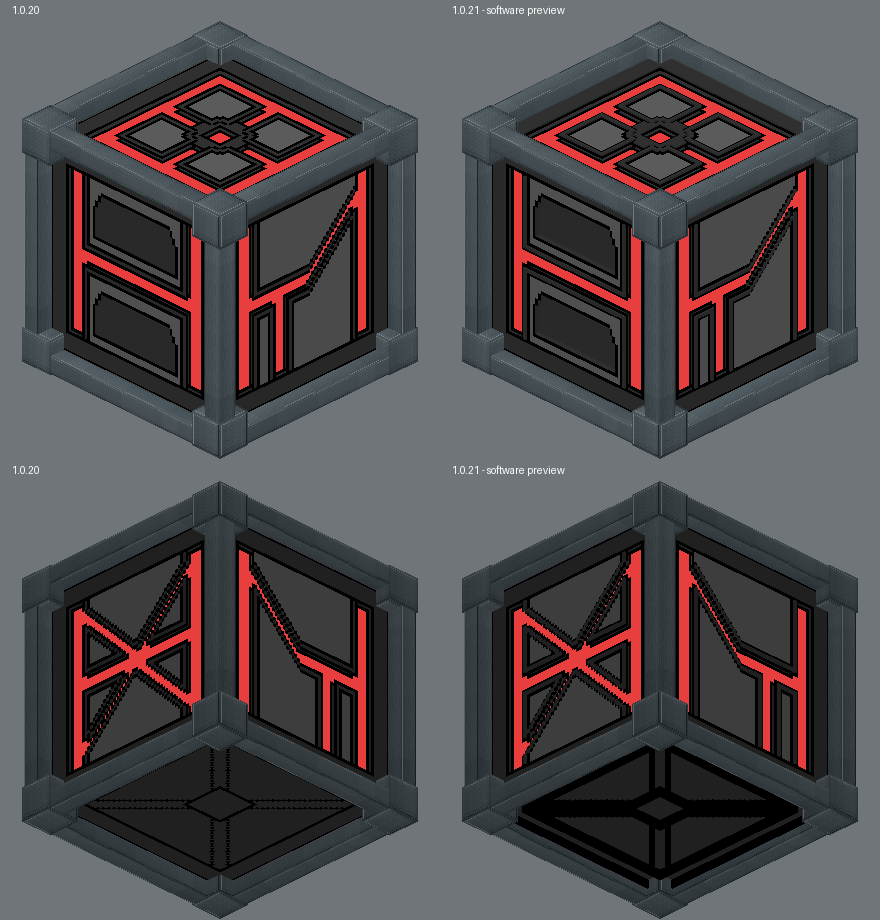
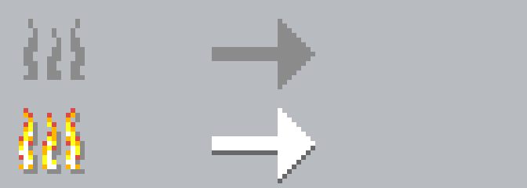

# Fornalhas Tech 1.0.21 — relevos e fundo dos indicadores

Origem: branch main, commit af35e36f6588061bdb97b1a0e885a78890587c0b (1.0.20).
Minecraft 1.19.2, Forge 43.5.0 e Java 17 preservados.

## Seleção e geometria

A seleção usa os pixels originais: cinza-escuro RGB 52/52/52, cinza-claro 99/99/99, preto 0/0/0 e as máscaras emissivas existentes. As pequenas regiões internas são separadas do grande anel exterior por componentes conectados; nenhuma seleção depende de espelhar uma lateral.

- Frente: 160 pixels de pequenos contornos cinza-escuros elevados em 0,125 unidade. As duas áreas internas cinza-escuras, 378 pixels cada, foram rebaixadas em 0,372 unidade, a mesma profundidade dos planos coloridos. Os contornos pretos e as regiões claras continuam na superfície original.
- Esquerda e direita: 192 pixels cinza-escuros em cada face elevados em 0,125 unidade.
- Traseira: 240 pixels cinza-escuros internos elevados em 0,125 unidade.
- Cima: cinza-escuro elevado em 0,125 unidade, inclusive o anel exterior, descontando as áreas fisicamente ocupadas pelas molduras e vértices.
- Baixo: linhas pretas elevadas em 0,625 unidade, metade da saliência de 1,25 das molduras. Não recebem tintindex nem emissividade. Trechos já ocultos pelas molduras/vértices são excluídos.

Os novos elementos têm superfícies e paredes laterais reais. Superfícies são agrupadas em retângulos; paredes internas entre retângulos não são emitidas. As diagonais seguem a escada dos pixels, sem suavização. Na frente, a superfície plana foi repartida para abrir as duas cavidades sem alterar os PNGs.

Todos os PNGs originais do bloco, os planos coloridos, os fundos rebaixados já aprovados, suas coordenadas/UV/tintindex/emissividade, as 12 molduras e os 8 cubos permanecem idênticos à 1.0.20. O Alto-Forno e o Defumador não foram redesenhados. O refinamento pertence ao modelo Base e à sua versão neutra.

## Indicadores

Causa: os quatro recortes do atlas vanilla incorporavam 738 pixels opacos de fundo #C6C6C6; o painel utiliza #B8BCC0. Isso gerava áreas claras ao redor dos ícones.

O recurso furnace_indicators.png mantém os quatro sprites nas mesmas coordenadas de um atlas 256x256, com exatamente os mesmos pixels RGB. Somente o alfa dos pixels de fundo #C6C6C6 foi zerado. O restante do atlas é transparente. Blend alfa é habilitado apenas para desenhar os indicadores.

Fonte do atlas vanilla 1.19.2 consultado: InventivetalentDev/minecraft-assets, commit ab03934287cc4262fdefe8c45b3f71d2a6708d11, assets/minecraft/textures/gui/container/furnace.png, blob f40de39d67a762e7de0e190b776fa0f0a1ed8b0b.

Posições, tamanhos, animações, cálculos de progresso, layout, menus, receitas, inventários, combustível, iluminação e navegação não foram modificados.

## Verificações

Validação automatizada contra a base: igualdade dos elementos protegidos; profundidade/altura dos novos planos; UV sem inversão; cobertura frontal completa sem faces superiores duplicadas; ausência de relevos novos sobre regiões claras ou emissivas; exclusão das molduras; PNGs do bloco byte a byte; preservação de todos os pixels dos ícones e retirada exclusivamente do fundo.

Os scripts tools/build_relief_1_0_21.py e tools/validate_relief_1_0_21.py exigem uma cópia intacta da base 1.0.20. O gerador rejeita reaplicação a um modelo já refinado, evitando duplicação.

A comparação abaixo foi renderizada por software a partir dos JSONs, com amostragem por vizinho mais próximo e teste de profundidade/alfa. Não é Minecraft; não simula integralmente luz, AO, shaders, resource packs ou desempenho do jogo.

Pendente dentro do Minecraft: inspeção em todas as orientações, blocos adjacentes, sombras, animações observadas e desempenho em cenas com muitas fornalhas. A compilação não comprova esses aspectos.
